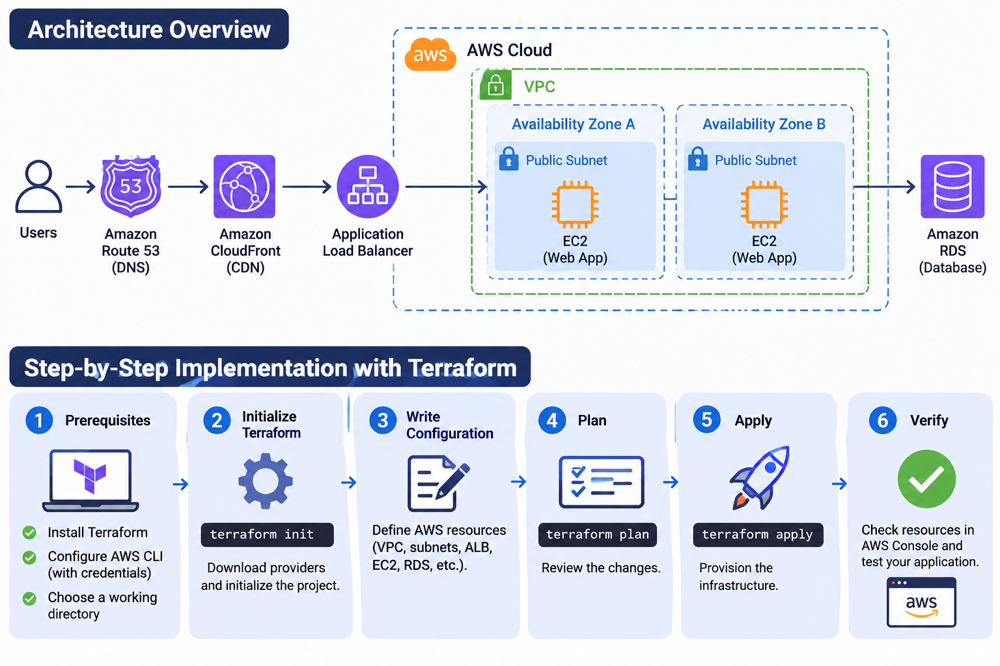

## Architecture



# AWS Infrastructure Provisioning with Terraform

## Project Overview

This project automates AWS infrastructure provisioning using Terraform. It creates a basic cloud environment with networking, security controls, and an EC2 web server.

The objective is to demonstrate Infrastructure as Code (IaC), repeatable deployments, resource management, and infrastructure drift detection.

## Architecture

- AWS VPC
- Public Subnet
- Internet Gateway
- Route Table
- Security Group
- EC2 Ubuntu Instance
- SSH Key Pair
- Nginx Web Server

## Technologies Used

- AWS
- Terraform
- Linux / Ubuntu
- Git
- GitHub
- Nginx

## Infrastructure

| Resource | Description |
|---|---|
| VPC | Isolated network |
| Internet Gateway | Internet connectivity |
| Public Subnet | Public-facing subnet |
| Route Table | Internet routing |
| Security Group | Network access control |
| EC2 | Ubuntu web server |
| SSH Key Pair | Secure remote access |

## Features

- Infrastructure provisioning using Terraform
- Reusable variables
- Resource tagging
- Automated EC2 initialization using user data
- SSH access restricted to a specified IP
- HTTP web server deployment
- Terraform plan and apply workflow
- Manual change detection using Terraform plan
- Infrastructure cleanup using Terraform destroy

## Deployment

### Initialize

```bash
terraform init
```

### Format

```bash
terraform fmt
```

### Validate

```bash
terraform validate
```

### Review

```bash
terraform plan
```

### Deploy

```bash
terraform apply
```

## Verification

After deployment:

- Verify EC2 status in AWS.
- Verify VPC and subnet.
- Verify security group rules.
- Open the Terraform output website URL.
- Connect using SSH.
- Verify Nginx service status.

## Drift Detection

A manual change to infrastructure through AWS Console is simulated by modifying an EC2 tag.

Terraform detects the difference between the configuration and actual AWS state using:

```bash
terraform plan
```

Terraform can then restore the expected configuration through an approved apply.

## Security

- SSH access restricted to a specified CIDR.
- EC2 root volume encrypted.
- Private SSH key excluded from Git.
- Terraform state excluded from Git.
- Resource tags used to identify ownership and environment.

## Cleanup

Remove the infrastructure after testing:

```bash
terraform destroy
```

Review the destroy plan and confirm only the resources belonging to this project are removed.

## Learning Outcomes

- AWS networking fundamentals
- Terraform configuration and lifecycle
- Infrastructure as Code
- AWS security groups
- EC2 provisioning
- Linux administration
- User data and bootstrap automation
- Terraform drift detection
- Git-based infrastructure version control